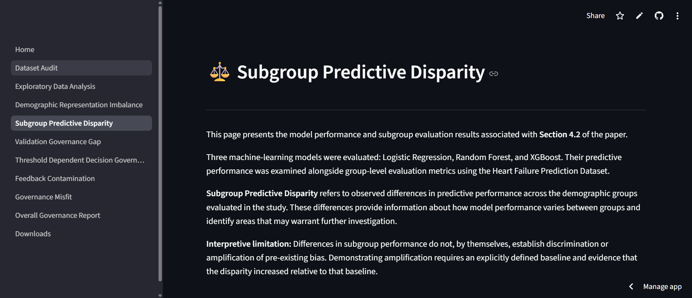

# Operational Evaluation of Governance Risks in Simulated Subjecthood

[](https://www.python.org/)
[](https://simulated-subjecthood.streamlit.app)
[](LICENSE)
[](https://github.com/AkaogorEmmanuelUkamaka/simulated_subjecthood/releases)
[](https://simulated-subjecthood.streamlit.app)

An interactive research dashboard and reproducible analytical pipeline for evaluating governance risks associated with **Simulated Subjecthood** in AI-enabled decision-making systems.

---

## 🌐 Live Dashboard

Explore the interactive dashboard:

**[Launch the Simulated Subjecthood Dashboard](https://simulated-subjecthood.streamlit.app)**

---

## 🖼️ Dashboard Preview

### 📊 Overall Governance Report


---

### 📈 Subgroup Predictive Disparity



---

## 📖 Project Overview

This project develops and operationalises an analytical framework for examining governance risks associated with simulated subjecthood in artificial intelligence systems.

Using a healthcare benchmark dataset, the project evaluates how computational systems can produce outputs that appear objective or authoritative while potentially concealing limitations in data representation, subgroup performance, model validation, decision thresholds, feedback processes, and institutional governance.

The accompanying Streamlit dashboard provides an interactive environment for exploring the empirical analyses, visualisations, and governance interpretations.

---

## 🎯 Research Objectives

The project investigates six dimensions of governance risk:

1. **Demographic Representation Imbalance:** Examines the distribution of demographic characteristics in the dataset and their implications for representation.
2. **Subgroup Predictive Disparity:** Evaluates differences in predictive performance across demographic subgroups.
3. **Validation–Governance Gap:** Examines the limitations of conventional model validation when considered alongside broader governance requirements.
4. **Threshold-Dependent Decision Governance:** Investigates how decision thresholds influence classification outcomes and associated governance trade-offs.
5. **Feedback Contamination:** Uses illustrative analysis to examine how feedback processes can affect subsequent computational outputs.
6. **Governance Misfit:** Explores potential misalignment between model-level evaluation and the institutional contexts in which computational decisions are applied.

---

## 📊 Dashboard Features

The interactive dashboard contains the following sections:

- **Home:** Project introduction, research context, and dashboard navigation.
- **Dataset Audit:** Overview of the dataset, variables, data quality, and preliminary checks.
- **Exploratory Data Analysis:** Descriptive statistics and visual exploration of the dataset.
- **Demographic Representation Imbalance:** Analysis of demographic distributions and representation.
- **Subgroup Predictive Disparity:** Evaluation of model performance across demographic subgroups.
- **Validation–Governance Gap:** Examination of model validation results and governance limitations.
- **Threshold-Dependent Decision Governance:** Analysis of threshold-sensitive classification outcomes.
- **Feedback Contamination:** Illustrative examination of feedback-related governance risks.
- **Governance Misfit:** Analysis of potential gaps between computational evaluation and institutional governance requirements.
- **Overall Governance Report:** Consolidated presentation of the governance findings.
- **Research Downloads:** Access to available research datasets, analytical outputs, figures, and reports.

---

## 🧰 Technology Stack

- **Programming Language:** Python
- **Dashboard Framework:** Streamlit
- **Data Analysis:** Pandas, NumPy
- **Machine Learning:** Scikit-learn, XGBoost
- **Data Visualisation:** Matplotlib, Seaborn
- **Development Environment:** Jupyter Notebook
- **Version Control:** Git and GitHub

---

## 📁 Repository Structure

```text
simulated_subjecthood/
│
├── dashboard/
│   ├── Home.py
│   ├── pages/
│   ├── assets/
│   │   └── images/
│   └── utils.py
│
├── data/
│   └── raw/
│
├── notebooks/
│
├── outputs/
│   ├── dataset/
│   ├── figures/
│   ├── reports/
│   └── tables/
│
├── src/
│
├── requirements.txt
├── README.md
└── LICENSE
```

---

## ⚙️ Installation and Setup

Follow these steps to run the project locally.

### 1. Clone the repository

```bash
git clone https://github.com/AkaogorEmmanuelUkamaka/simulated_subjecthood.git
```

### 2. Navigate into the project directory

```bash
cd simulated_subjecthood
```

### 3. Create a virtual environment

```bash
python -m venv .venv
```

### 4. Activate the virtual environment

**Windows PowerShell:**

```powershell
.venv\Scripts\Activate.ps1
```

**macOS / Linux:**

```bash
source .venv/bin/activate
```

### 5. Install dependencies

```bash
pip install -r requirements.txt
```

### 6. Launch the dashboard

```bash
streamlit run dashboard/Home.py
```

The dashboard will open in your default browser. If it does not, use the local URL displayed in your terminal.

---

## 📦 Project Outputs

The repository includes analytical materials associated with the research, including:

- Dataset audit and exploratory analysis outputs.
- Model evaluation and subgroup performance results.
- Governance analysis tables.
- Visualisations and figures.
- Consolidated governance reporting materials.

---

## 📚 Dataset

The empirical analysis uses the **[Heart Failure Prediction Dataset](https://www.kaggle.com/datasets/fedesoriano/heart-failure-prediction)**, made available by Fedesoriano on Kaggle.

The dataset provides a healthcare benchmark for examining classification performance and selected demographic and clinical variables.

---

## 🔬 Research and Analytical Scope

The project distinguishes between empirical model evaluation, illustrative simulations, and conceptual governance interpretation.

Empirical findings are grounded in the dataset and analytical procedures used in the project. Illustrative simulations are used to explore possible governance mechanisms and should not be interpreted as direct evidence of real-world institutional outcomes.

The analyses are intended to support critical examination of the relationship between predictive performance, computational representation, and institutional governance. They do not establish clinical validity or prove that a model is suitable for deployment in a real healthcare setting.

---

## 📄 License

This project is licensed under the MIT License. See the [LICENSE](LICENSE) file for details.
