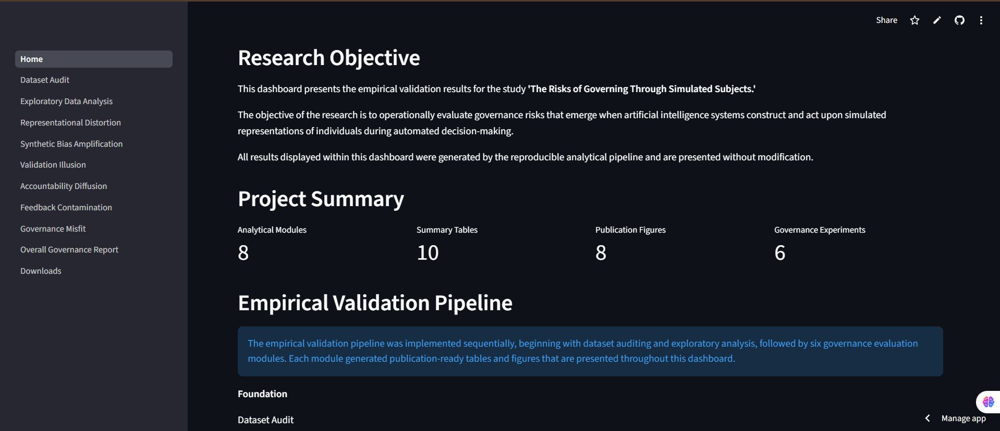
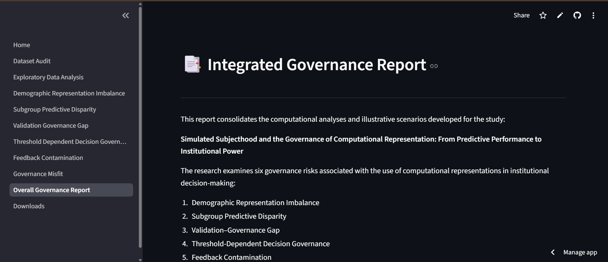

# Operational Evaluation of Governance Risks in Simulated Subjecthood

[](https://www.python.org/)
[](https://simulated-subjecthood.streamlit.app)
[](LICENSE)
[](https://github.com/AkaogorEmmanuelUkamaka/simulated_subjecthood/releases)
[](https://simulated-subjecthood.streamlit.app)

An interactive research dashboard and reproducible analytical pipeline for evaluating governance risks associated with **Simulated Subjecthood** in AI-enabled decision-making systems.

---

## 🌐 Live Dashboard

🔗 **Interactive Dashboard:** https://simulated-subjecthood.streamlit.app

---

## 🖼️ Dashboard Preview

### 🏠 Home Page



---

### 📊 Overall Governance Report



---

## 📖 Project Overview

This project presents an operational framework for evaluating governance risks arising from simulated subjecthood in artificial intelligence systems.

The accompanying multi-page Streamlit dashboard provides an interactive and reproducible environment for examining dataset characteristics, demographic representation, predictive performance, subgroup disparities, model calibration, threshold-dependent decisions, feedback dynamics, and governance constraints.

Using the publicly available Heart Failure Prediction Dataset, the project combines empirical machine learning evaluation with illustrative simulations and conceptual governance analysis.

The framework distinguishes between observed computational findings, simulated scenarios, and broader governance interpretations. This distinction is important because predictive performance alone does not establish fairness, institutional accountability, or deployment readiness.

---

## 🎯 Research Objectives

The project investigates governance risks across six interconnected dimensions of the AI lifecycle:

1. **Demographic Representation Imbalance** – examines demographic distribution and alignment with an equal-representation reference.
2. **Subgroup Predictive Disparity** – evaluates differences in predictive performance across demographic groups.
3. **Validation–Governance Gap** – examines the distinction between model validation evidence and broader governance assurance.
4. **Threshold-Dependent Decision Governance** – investigates how decision thresholds influence allocation outcomes.
5. **Feedback Contamination** – explores how feedback dynamics may affect subsequent system performance through an illustrative simulation.
6. **Governance Misfit** – examines illustrative tensions between model-driven decisions and institutional governance constraints.

The analyses are designed to support critical evaluation of the relationship between predictive performance and institutional responsibility.

---

## 📊 Dashboard Features

The interactive dashboard contains the following sections:

- Home
- Dataset Audit
- Exploratory Data Analysis
- Demographic Representation Imbalance
- Subgroup Predictive Disparity
- Validation–Governance Gap
- Threshold-Dependent Decision Governance
- Feedback Contamination
- Governance Misfit
- Overall Governance Report
- Research Downloads

The dashboard provides access to analytical summaries, publication figures, research tables, and downloadable project artefacts.

---

## 🛠️ Technology Stack

- Python
- Streamlit
- Pandas
- NumPy
- Scikit-learn
- XGBoost
- Matplotlib
- Seaborn
- Jupyter Notebook
- Git and GitHub

---

## ⭐ Key Contributions

- Developed an operational framework for evaluating governance risks associated with simulated subjecthood.
- Implemented a reproducible analytical pipeline for empirical AI governance research.
- Evaluated machine learning performance and subgroup predictive disparities.
- Examined calibration, bootstrap uncertainty, and threshold-dependent allocation outcomes.
- Developed illustrative simulations for feedback dynamics and governance constraints.
- Designed a multi-page Streamlit dashboard for transparent exploration of research findings.
- Produced publication-oriented tables, figures, and downloadable research artefacts.

---

## 📁 Repository Structure

```text
simulated_subjecthood/
│
├── dashboard/
│   ├── Home.py
│   ├── pages/
│   └── utils.py
│
├── data/
│   ├── raw/
│   └── processed/
│
├── notebooks/
│
├── outputs/
│   ├── dataset/
│   ├── figures/
│   ├── models/
│   ├── reports/
│   └── tables/
│
├── src/
│
├── requirements.txt
├── README.md
└── LICENSE
```

---

## 🚀 Installation

### 1. Clone the repository

```bash
git clone https://github.com/AkaogorEmmanuelUkamaka/simulated_subjecthood.git
```

### 2. Navigate into the project directory

```bash
cd simulated_subjecthood
```

### 3. Create and activate a virtual environment (recommended)

```bash
python -m venv .venv
```

Windows PowerShell:

```powershell
.venv\Scripts\Activate.ps1
```

### 4. Install dependencies

```bash
pip install -r requirements.txt
```

### 5. Launch the Streamlit dashboard

```bash
streamlit run dashboard/Home.py
```

Alternatively:

```bash
python -m streamlit run dashboard/Home.py
```

---

## 📦 Project Outputs

The project includes:

- Publication-oriented analytical tables
- Research visualisations and figures
- Machine learning evaluation results
- Model performance metrics
- Subgroup evaluation and fairness-related metrics
- Bootstrap uncertainty estimates
- Calibration analyses
- Threshold-dependent allocation simulations
- Feedback and governance simulation outputs
- Downloadable research artefacts

The notebooks and source modules support the analytical workflow, while the dashboard provides an accessible interface for exploring the generated results.

---

## 📂 Dataset

The empirical analyses use the publicly available **Heart Failure Prediction Dataset**.

- **Author:** Fedesoriano
- **Platform:** Kaggle
- **Purpose:** Benchmark healthcare dataset used to examine predictive performance and selected governance risks associated with simulated subjecthood.

Dataset:

https://www.kaggle.com/datasets/fedesoriano/heart-failure-prediction

---

## 🙏 Acknowledgements

This project was developed as part of ongoing research into AI governance, accountability, fairness, transparency, and simulated subjecthood.

Special appreciation is extended to collaborators, mentors, and the open-source community whose tools and resources supported the development of this work.

---

## 📄 License

This project is licensed under the **MIT License**. See the `LICENSE` file for details.
