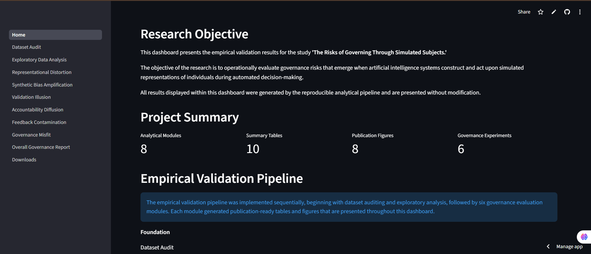
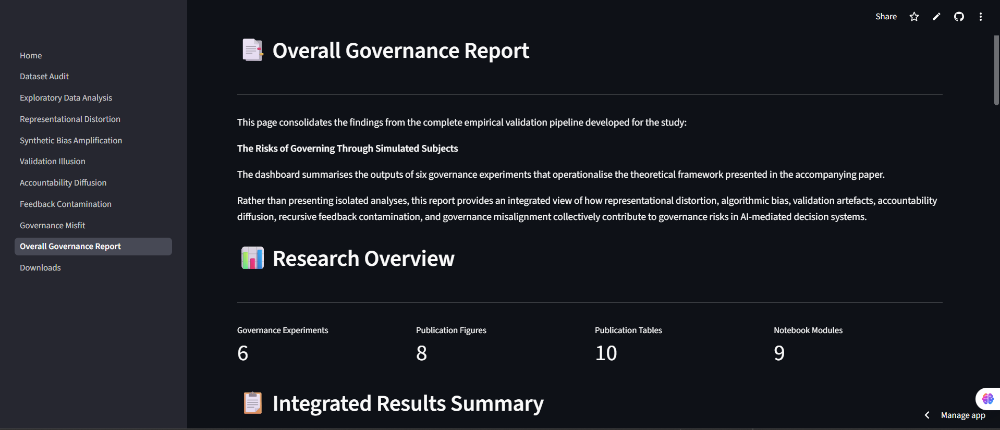

# Operational Evaluation of Governance Risks in Simulated Subjecthood

[](https://www.python.org/)
[](https://simulated-subjecthood.streamlit.app)
[](LICENSE)
[](https://github.com/AkaogorEmmanuelUkamaka/simulated_subjecthood/releases)
[](https://simulated-subjecthood.streamlit.app)

An interactive research dashboard and reproducible analytical pipeline for evaluating governance risks associated with **Simulated Subjecthood** in AI-enabled decision-making systems.

---

## 🌐 Live Dashboard

🔗 **Interactive Dashboard:** <https://simulated-subjecthood.streamlit.app>

---

## 🖼️ Dashboard Preview

### 🏠 Home Page



---

### 📊 Overall Governance Report



---

## 📖 Project Overview

This project presents an operational framework for empirically evaluating governance risks arising from simulated subjecthood in artificial intelligence systems.

The accompanying dashboard provides a transparent, reproducible environment for analysing dataset quality, representational integrity, predictive performance, fairness, calibration, accountability, feedback contamination, and governance trade-offs using a healthcare benchmark dataset.

---

## 🎯 Research Objectives

The project investigates how governance failures emerge across the AI lifecycle through empirical evaluation of:

- Dataset quality
- Representational distortion
- Synthetic bias amplification
- Validation illusion
- Accountability diffusion
- Feedback contamination
- Governance misfit

---

## 📊 Dashboard Features

The interactive dashboard contains:

- Dataset Audit
- Exploratory Data Analysis
- Representational Distortion
- Synthetic Bias Amplification
- Validation Illusion
- Accountability Diffusion
- Feedback Contamination
- Governance Misfit
- Overall Governance Report
- Research Download Centre

---

## 🛠️ Technology Stack

- Python
- Streamlit
- Pandas
- NumPy
- Scikit-learn
- XGBoost
- Matplotlib
- Seaborn
- Jupyter Notebook
- Git & GitHub

---

## ⭐ Key Contributions

- Developed an operational framework for evaluating governance risks associated with simulated subjecthood.
- Built an end-to-end reproducible analytical pipeline for empirical AI governance research.
- Produced publication-ready tables, figures, and governance metrics.
- Designed a multi-page interactive Streamlit dashboard for transparent exploration of results.
- Integrated downloadable research artefacts to promote reproducibility and open scientific practice.

---

## 📁 Repository Structure

```text
dashboard/
│
├── Home.py
├── pages/

data/
│
├── raw/

notebooks/

outputs/
├── dataset/
├── figures/
├── models/
├── reports/
└── tables/

src/

README.md
requirements.txt
```

---

## 🚀 Installation

Clone the repository:

```bash
git clone https://github.com/AkaogorEmmanuelUkamaka/simulated_subjecthood.git
```

Navigate into the project directory:

```bash
cd simulated_subjecthood
```

Install the required dependencies:

```bash
pip install -r requirements.txt
```

Launch the Streamlit dashboard:

```bash
streamlit run dashboard/Home.py
or
python -m streamlit run dashboard/Home.py
```

---

## 📦 Project Outputs

The analytical pipeline generates:

- Publication-ready tables
- Publication-ready figures
- Trained machine learning models
- Governance metrics
- Fairness evaluations
- Calibration analyses
- Downloadable research artefacts

All outputs are automatically generated from the analytical workflow to ensure transparency and reproducibility.

---

## 📂 Dataset

The empirical analyses presented in this project use the publicly available **Heart Failure Prediction Dataset**.

- **Author:** Fedesoriano
- **Platform:** Kaggle
- **Purpose:** Benchmark healthcare dataset used to evaluate governance risks associated with simulated subjecthood.

Dataset:
<https://www.kaggle.com/datasets/fedesoriano/heart-failure-prediction>


## 🙏 Acknowledgements

This project was developed as part of ongoing research into AI governance, accountability, fairness, transparency, and simulated subjecthood.

Special appreciation is extended to collaborators, mentors, and the open-source community whose tools and resources supported the development of this work.

---

## 📄 License

This project is licensed under the **MIT License**. See the `LICENSE` file for details.